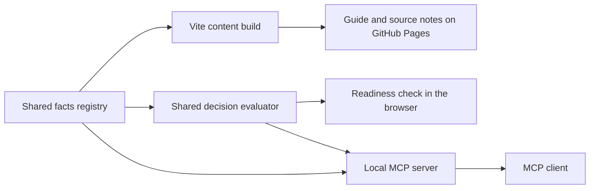

# Sparkfolio


Sparkfolio is a free investing guide for readers in India. It explains topics like emergency savings, insurance, asset allocation and taxes, with worked examples and links to sources.

[Open the guide](https://sparkience-ai.github.io/sparkfolio/) · [Try the readiness check](https://sparkience-ai.github.io/sparkfolio/#agent)

The readiness check uses your answers to flag what to look at next. For example, it can prompt you to check how long your emergency savings would last or whether you can afford a loss before a goal comes due. Tax examples show how the arithmetic works under stated assumptions. The check is educational and gives no personal investment or tax advice. Your answers stay in your browser for the session.

## Run locally

Use Node.js 24. In a checkout of this repo, run:

```sh
npm ci
npm run dev
```

Open the URL printed by Vite and go to `/sparkfolio/`. Before opening a pull request, run `npm run check` to validate the site, decision rules, agent tools and browser interactions.

## How Sparkfolio works

Sparkfolio is a static site built with Vite and hosted on GitHub Pages. Vite fills in the HTML guide and its source notes at build time. In the browser, JavaScript turns form answers into readiness cards. A separate local server exposes the same decision logic to tools that support the Model Context Protocol (MCP).



- **Single source of truth (SSoT).** The facts registry holds claim values, source links, applicable periods, review dates and the decision model’s tax settings. The content builder uses it to render the public guide and source notes. The MCP tools read the same registry for evidence lookups. [Facts registry](src/data/framework-facts.json) · [Content builder](scripts/content.js) · [Facts governance](docs/FACTS_GOVERNANCE.md)
- **Decision engine.** The evaluator turns explicit answers into cards about financial basics, when the money is needed, capacity for loss and tax context. The browser and MCP server run the same evaluator, so the same answers produce the same cards. [Evaluator code](src/decision.js) · [Rules, result cards and worked examples](docs/DECISION_ENGINE_MODEL.md)

### Local MCP server

GitHub Pages hosts the web guide. The MCP server runs locally from a checkout and connects to a compatible stdio client.

After `npm ci`, run `npm run mcp` from the repo root. For a client that launches its own server process, configure `node src/mcp-server.js` from the checkout. The server communicates over standard input and output and offers three read-only tools:

| Tool | What it returns |
| --- | --- |
| `list_claims` | Discover registered claims and their evidence status. |
| `get_claim` | Look up one claim, including its sources, applicable period and limits. |
| `review_readiness` | Run the educational check with complete answers and an explicit evidence date. |

See the [MCP setup and tool reference](docs/AGENT_SURFACE.md) for protocol support, evidence dates and evaluation instructions. The [Codex CLI pilot](docs/CODEX_MCP_PILOT.md) records the tested setup, outcomes and evaluation limits.

## Project documentation

- [Release and rollback](docs/RELEASE.md) covers the GitHub Actions checks, deployment and recovery.
- [Quality evidence](docs/QUALITY.md) explains the automated checks and the manual reviews still needed.
- [Threat model](docs/THREAT_MODEL.md) explains how the website and local tools handle data.
- [Documentation index](docs/README.md) collects the full references, claim audits and content change history.

Sparkfolio contributors maintain the guide. To report a factual correction, see [support and corrections](SUPPORT.md). For code changes, see [contributing](CONTRIBUTING.md). The project uses the [MIT License](LICENSE).
